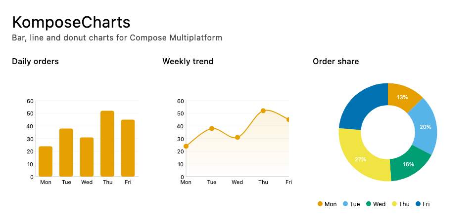

# KomposeCharts

Bar, line, pie, and donut charts for Kotlin and Compose Multiplatform. Share your chart data and UI across Android, iOS, and desktop.



## What you can build

- Grouped, stacked, and percent-stacked bars, with horizontal and vertical layouts.
- Straight or smooth lines, markers, area fills, and gaps for missing data.
- Pie and donut charts with labels and legends.
- Animated entry, optional tooltips, selection, interactive legends, and reference lines.
- Shared chart themes and an optional Material 3 theme bridge.

## Release status

The configured version is **0.2.0-rc.2**, a pre-release candidate. JitPack installation requires the metadata workaround below for shared Kotlin compilation and source downloads. Stable release verification is in progress.

See the [changelog](CHANGELOG.md) for changes being prepared.

## Platforms and requirements

| Target | Configuration |
| --- | --- |
| Android | minSdk 24; library compiled with SDK 35 |
| iOS | Sample requires iOS 16+; library targets device arm64 and simulator arm64/x64 |
| Desktop JVM | Java 17+ bytecode target |

Built with Kotlin 2.1.20 and Compose Multiplatform 1.8.0. Building this repository requires JDK 21. iOS application builds require macOS and Xcode. Web targets are not configured. These are build targets, not a claim of testing every OS/device combination.

## Installation

**Required:** follow [the complete JitPack installation guide](INSTALLATION.md), including its `components` workaround in `settings.gradle.kts`. The repository and dependency snippets alone are insufficient because JitPack rewrites source and iOS metadata filenames.

Add JitPack to `settings.gradle.kts`:

```kotlin
dependencyResolutionManagement {
    repositories {
        google()
        mavenCentral()
        maven("https://jitpack.io")
    }
}
```

Add the library to your shared module's `build.gradle.kts`:

```kotlin
kotlin {
    sourceSets {
        commonMain.dependencies {
            implementation("com.github.meetkparmar.KomposeCharts:charts:0.2.0-rc.2")
        }
    }
}
```

Your shared module must already be configured for Compose Multiplatform. Add only `charts`; the `core` data types are included transitively. Keep the repository name's capitalization exactly as shown.

## Your first chart

```kotlin
import androidx.compose.runtime.Composable
import androidx.compose.runtime.remember
import androidx.compose.ui.Modifier
import androidx.compose.foundation.layout.fillMaxWidth
import io.github.komposeCharts.charts.BarChart
import io.github.komposeCharts.core.data.ChartData

@Composable
fun WeeklyOrders() {
    val orders = remember {
        ChartData(
            values = listOf(24f, 38f, 31f, 52f, 45f),
            labels = listOf("Mon", "Tue", "Wed", "Thu", "Fri"),
            seriesLabel = "Orders",
        )
    }
    BarChart(data = orders, modifier = Modifier.fillMaxWidth())
}
```

Use `LineChart(data = orders)` for a line chart. For a donut, use `PieChart(data = orders, style = PieChartStyle(donut = true))` with imports from `io.github.komposeCharts.charts` and `io.github.komposeCharts.style`.

`ChartData` also accepts named `DataSeries` containing `DataPoint` values. Pie charts use the first series only. For line gaps, use `DataPoint.missing(x)`. Tooltips and selection styling are optional settings on each chart's style.

## Explore the samples

| Sample | Run it |
| --- | --- |
| [Desktop](samples/desktop) | `./gradlew :samples:desktop:run` |
| [Android](samples/android) | Open the repository in Android Studio and run `samples:android`. |
| [iOS](samples/ios/iosApp) | Open `samples/ios/iosApp/iosApp.xcodeproj` in Xcode and run `iosApp` on a simulator. |
| [Shared chart demos](samples/common/src/commonMain/kotlin/io/github/komposeCharts/sample) | Examples used by all three hosts. |

Samples use the local library by default and do not require a published release.

## API documentation

Generate and open the reference locally:

```sh
./gradlew :core:dokkaHtml :charts:dokkaHtml
```

Open `charts/build/dokka/html/index.html` for chart APIs and `core/build/dokka/html/index.html` for data types. The [documentation workflow](.github/workflows/docs.yml) is prepared for GitHub Pages. Its planned address is `https://meetkparmar.github.io/KomposeCharts/`; hosting is not yet verified. No build/version badges are shown until their published destinations are verified.

## Contributing

See [CONTRIBUTING.md](CONTRIBUTING.md) for setup, checks, and API compatibility guidance. Bug reports should include the platform, library version, a small data sample, and reproduction steps.

## License

[Apache License 2.0](LICENSE). Copyright 2026 KomposeCharts Contributors.
